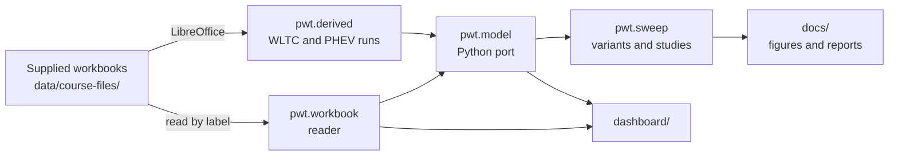
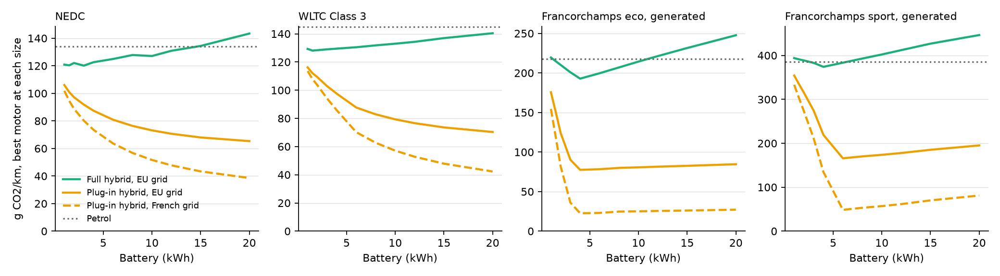
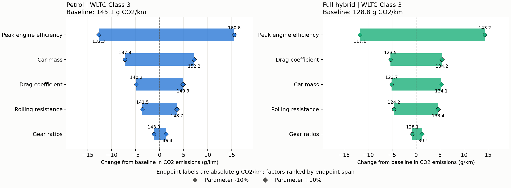
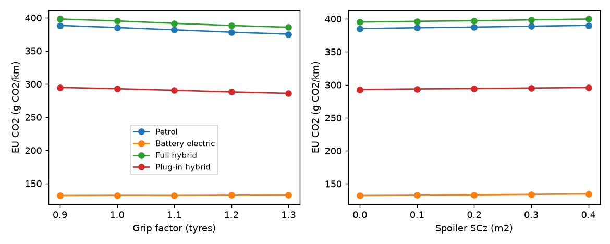

# PWT CO2 Simulation

Group project for PWT — Powertrains (MESISI471226, Marc Nelis), ESILV 2026-Autumn.

The course's spreadsheet CO2 model, ported to Python and extended. It compares a petrol car, a battery-electric car, a full hybrid and a plug-in hybrid over NEDC, WLTC Class 3 and two Spa-Francorchamps laps (eco and sport).



## Quick start

```sh
python3 -m venv .venv
.venv/bin/pip install -r requirements.txt
.venv/bin/python -m pytest tests
```

The tests are golden: the reader and the model must reproduce every workbook's totals. For example, the petrol car on the Francorchamps eco lap gives **10.273 l/100 km** and **245.7 g CO2/km**.

## Layout

| Path | Contents |
|---|---|
| `data/course-files/` | The 23 files Nelis supplied. **Read-only.** |
| `data/derived/` | WLTC and plug-in hybrid workbooks built by `python -m pwt.derived` |
| `data/track/` | Spa-Francorchamps outline from [bacinger/f1-circuits](https://github.com/bacinger/f1-circuits) (MIT) |
| `pwt/` | Workbook reader, derived-workbook builder, sweeps and studies. No Streamlit. |
| `pwt/model/` | The spreadsheet model in Python |
| `dashboard/` | Streamlit viewer ([dashboard/README.md](dashboard/README.md)) |
| `docs/` | Equations, results, study reports and sources |

## The model

`from_workbook(run)` reproduces any supplied or derived workbook exactly, totals and every per-step column. `simulate(vehicle, cycle, conventions, strategy)` takes the inputs separately, which is how anything gets changed.

| Module | Holds |
|---|---|
| `conventions.py` | What the workbooks disagree on, one record per file, and `harmonised()` |
| `vehicle.py`, `cycle.py` | Inputs, read from a workbook's block and trace |
| `road_load.py`, `powertrains.py` | Forces, then the petrol, electric and hybrid chains |
| `strategy.py` | The sheets' motor-share rule and a charge-sustaining band |
| `constants.py`, `fleet.py` | Cited constants ([docs/sources.md](docs/sources.md)) and the assignment's vehicles |
| `profile.py` | Francorchamps laps generated from the assignment's eco and sport rules |

Every column is written out as an equation in [docs/model-equations.md](docs/model-equations.md). How the reader copes with the workbooks' differing layouts, and what `pwt.derived` builds, is in [docs/workbooks.md](docs/workbooks.md).

## Results and studies

Each figure is regenerated by the command under it.

**Phase 1–2: the base comparison.** `python -m pwt.checkpoint` prints the 4 × 4 table in [docs/phase-1-results.md](docs/phase-1-results.md). `python -m pwt.phase2` prints the five-scenario comparison in [docs/phase-2-results.md](docs/phase-2-results.md).

**Study A: sizing the hybrids** ([docs/phase-3-sizing.md](docs/phase-3-sizing.md)). CO2 against battery size, with the best motor at each size.



`python -m pwt.sweep`

**Study B: one-factor CO2 sensitivity** ([docs/study-b-sensitivity.md](docs/study-b-sensitivity.md)). Each parameter moved by ±10 %, one at a time.



`pip install -r requirements-study-b.txt`, then `python -m pwt.sensitivity_report`

**Study C: cornering speed** ([docs/study-c-cornering.md](docs/study-c-cornering.md)). Sport-lap CO2 against tyre grip and spoiler size.



`pip install -r requirements-study-c.txt`, then `python -m pwt.cornering`

The study reports are drafts that belong to their owners. See [AGENTS.md](AGENTS.md) for the rules on working in this repo.

## The deck

Write the slide text in `docs/deck/slides.md`, then build both PowerPoint themes with:

```sh
.venv/bin/pip install -r requirements-deck.txt
.venv/bin/python -m pwt.deck
```

The full guide is in [docs/deck/README.md](docs/deck/README.md).

## Dashboard

An internal viewer, not a deliverable: <https://pwt-co2-simulation-iihscdva9b3woycsyuk7dp.streamlit.app>. Run it locally with `.venv/bin/streamlit run dashboard/Overview.py`. **Reboot the Cloud app after any change to `pwt/`**, because it doesn't re-import that package on push. Pages and details are in [dashboard/README.md](dashboard/README.md).
