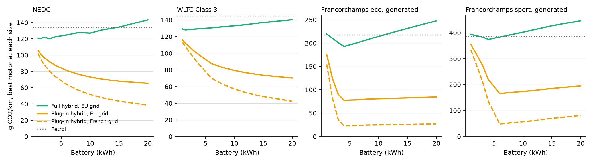

# Phase 3: sizing the hybrids

**Study A** of the three personal studies. Every figure below comes from `python -m pwt.sweep`, which prints the tables and writes `docs/phase-3-sizing.png`. `pwt/sweep.py` takes any set of vehicle variants, so the tornado study can use the same harness.

## What had to change first

Two gaps would have decided the answer on their own, so both were fixed before sweeping. A third appeared in the first sweep.

- **Storage was free.** The hybrids now lose 15 % each way through motor, inverter and battery (`storage_efficiency`, the "storage losses" scenario). The figure is an assumption: 0.85² is about the 70 % round-trip regenerative efficiency Boretti reports (`docs/sources.md`).
- **Motor size weighed nothing.** Machine mass now follows the DOE's 1.4 kW/kg traction-drive target, anchored at the sheet's 100 kg at 35 kW (93 kg at 25 kW, 132 kg at 80 kW).
- **Batteries had no power limit.** The first sweep chose 1 kWh with 80 kW on the laps, which is 80C. Results now exclude anything above 20C, an assumption just above the assignment hybrid's 16.7C.

The sweep uses the assignment vehicles on NEDC, WLTC and the generated laps. Batteries run from 1 to 20 kWh and motors from 20 to 80 kW, at 150 Wh/kg. The strategies stay fixed: the band for the full hybrid and the sheets' rule for the plug-in hybrid.

## Findings

- **Storage losses overturn the Phase 2 band result.** With free storage the band beats the sheets' rule on every cycle. At 85 % each way it loses on NEDC (123.7 against 121.1 g/km) and WLTC (128.8 against 123.7), and still wins on the laps. The crossover on WLTC is near 91 %. The band charges the battery from the engine, and that energy now pays a loss going in and another coming out.
- **The full hybrid's advantage over petrol shrinks.** On WLTC it falls from 28 % to 11 %. On the generated eco lap the 1.5 kWh, 25 kW car (218.8 g/km) ends level with petrol (217.5), and on the sport lap it is worse (395.2 against 385.2). A larger hybrid recovers some of this: 4 kWh with 80 kW reaches 192.8 and 374.0 g/km.
- **A full hybrid needs little battery on the regulatory cycles.** On WLTC, CO2 stays within 2 g/km from 1 to 4 kWh, then rises steadily with mass. The best size is 1.5 kWh with 30 kW, at 128.1 g/km. On NEDC, sizes from 1 to 3 kWh are within the cycle's resolution (see below).
- **Hard driving wants power, not energy.** On both generated laps the best full hybrid is 4 kWh with 80 kW, where the limits meet: 80 kW is the top of the grid, and 4 kWh is the smallest pack the 20C limit allows at that power. It is therefore a boundary of the assumptions, not a free optimum. More motor recovers more of the braking.
- **The plug-in hybrid has no real optimum here, and two different shapes.**
  - On NEDC and WLTC, CO2 falls all the way to the 20 kWh edge. R101 rewards electric range by construction, so this is a property of the weighting, not a best size. Past about 8 kWh each extra kWh buys little: 76.4 to 65.3 g/km on NEDC from 8 to 20 kWh.
  - On a single lap the battery stops mattering once it covers the lap (about 4 kWh eco, 6 kWh sport). Beyond that it only adds mass. This depends on trip length and says nothing about a real car's use.
- **The French grid changes the level, not the sizes.** The best sizes are the same on both grids. The plug-in hybrid's advantage grows, for example 70.3 to 42.3 g/km on WLTC at 20 kWh.

## Reading the numbers

- **NEDC differences under about 4 g/km mean nothing.** On an 11 km cycle a small size change moves where the last charging event ends, so the curve jitters. Do not quote the NEDC "best" of 3 kWh as an optimum.
- **Grid-edge results are not optima.** The laps' 80 kW and the plug-in hybrid's 20 kWh are both at the edge.
- **The strategy is not re-tuned for each size.** A full hybrid with its band and charge target tuned to storage losses would do better than these figures, probably by enough to matter given the crossover above. This is the obvious next step.
- **Both new assumptions matter.** The 85 % moves the full hybrid by about 8 g/km per 5 points on WLTC. The 20C limit sets the laps' answer.
- **The engine stays at 74 kW.** Downsizing it alongside a larger motor is not tested.

The dashboard's **Sizing** page shows these findings one chart at a time, and **Track map** shows any generated lap on the real circuit.

## The assignment's full hybrid by storage efficiency (g CO2/km)

|                        |   NEDC |   WLTC Class 3 |   Francorchamps eco, generated |   Francorchamps sport, generated |
|:-----------------------|-------:|---------------:|-------------------------------:|---------------------------------:|
| (1.0, 'band')          |   98.7 |          104.8 |                          197   |                            382.8 |
| (1.0, "sheets' rule")  |  107   |          110.7 |                          201.3 |                            383.1 |
| (0.95, 'band')         |  106.3 |          112.2 |                          204.1 |                            386.9 |
| (0.95, "sheets' rule") |  112.5 |          115.1 |                          208.6 |                            390.3 |
| (0.9, 'band')          |  112.7 |          120.1 |                          211.5 |                            391.1 |
| (0.9, "sheets' rule")  |  116.7 |          119.4 |                          216.2 |                            397.7 |
| (0.85, 'band')         |  123.7 |          128.8 |                          218.8 |                            395.2 |
| (0.85, "sheets' rule") |  121.1 |          123.7 |                          224   |                            405.3 |
| (0.8, 'band')          |  129.7 |          137.9 |                          226.3 |                            399.4 |
| (0.8, "sheets' rule")  |  124.8 |          127.9 |                          231.9 |                            412.9 |

Petrol on the same cycles: NEDC 134.1, WLTC Class 3 145.1, Francorchamps eco, generated 217.5, Francorchamps sport, generated 385.2.

## Best size per cycle, EU grid (250 g/kWh)

| powertrain     | cycle                          |   best battery (kWh) |   best motor (kW) |   mass (kg) |   g CO2/km |   worst in grid |   steps short |
|:---------------|:-------------------------------|---------------------:|------------------:|------------:|-----------:|----------------:|--------------:|
| Full hybrid    | NEDC                           |                  3   |                20 |        1469 |      120.1 |           148.8 |             0 |
| Full hybrid    | WLTC Class 3                   |                  1.5 |                30 |        1466 |      128.1 |           141.8 |             0 |
| Full hybrid    | Francorchamps eco, generated   |                  4   |                80 |        1519 |      192.8 |           264.9 |             0 |
| Full hybrid    | Francorchamps sport, generated |                  4   |                80 |        1519 |      374   |           474.3 |             0 |
| Plug-in hybrid | NEDC                           |                 20   |                50 |        1604 |       65.3 |           106   |             1 |
| Plug-in hybrid | WLTC Class 3                   |                 20   |                50 |        1604 |       70.3 |           116.2 |            35 |
| Plug-in hybrid | Francorchamps eco, generated   |                  4   |                80 |        1519 |       77.5 |           175.6 |             0 |
| Plug-in hybrid | Francorchamps sport, generated |                  6   |                80 |        1532 |      165.9 |           365.1 |             0 |

## Best size per cycle, French grid (73 g/kWh)

| powertrain     | cycle                          |   best battery (kWh) |   best motor (kW) |   mass (kg) |   g CO2/km |   worst in grid |   steps short |
|:---------------|:-------------------------------|---------------------:|------------------:|------------:|-----------:|----------------:|--------------:|
| Full hybrid    | NEDC                           |                  3   |                20 |        1469 |      120.1 |           148.8 |             0 |
| Full hybrid    | WLTC Class 3                   |                  1.5 |                30 |        1466 |      128.1 |           141.8 |             0 |
| Full hybrid    | Francorchamps eco, generated   |                  4   |                80 |        1519 |      192.8 |           264.9 |             0 |
| Full hybrid    | Francorchamps sport, generated |                  4   |                80 |        1519 |      374   |           474.3 |             0 |
| Plug-in hybrid | NEDC                           |                 20   |                50 |        1604 |       38.6 |           101.8 |             1 |
| Plug-in hybrid | WLTC Class 3                   |                 20   |                50 |        1604 |       42.3 |           113.5 |            35 |
| Plug-in hybrid | Francorchamps eco, generated   |                  4   |                80 |        1519 |       22.6 |           154.6 |             0 |
| Plug-in hybrid | Francorchamps sport, generated |                  6   |                80 |        1532 |       48.4 |           336.6 |             0 |

## Full hybrid: g CO2/km by battery, best motor at each size

|   battery_kwh |   NEDC |   WLTC Class 3 |   Francorchamps eco, generated |   Francorchamps sport, generated |
|--------------:|-------:|---------------:|-------------------------------:|---------------------------------:|
|           1   |  120.9 |          129.3 |                          219.5 |                            393.9 |
|           1.5 |  120.3 |          128.1 |                          214.8 |                            391.1 |
|           2   |  122   |          128.4 |                          210.1 |                            388.6 |
|           3   |  120.1 |          129   |                          200.8 |                            383   |
|           4   |  122.6 |          129.5 |                          192.8 |                            374   |
|           6   |  124.9 |          130.5 |                          199.6 |                            383.4 |
|           8   |  127.8 |          131.8 |                          207   |                            393   |
|          10   |  127.1 |          133   |                          214.4 |                            402.2 |
|          12   |  130.9 |          134.3 |                          221.4 |                            412.1 |
|          15   |  134.4 |          136.9 |                          231.5 |                            426.9 |
|          20   |  143.4 |          140.4 |                          247.7 |                            446.4 |

## Plug-in hybrid: g CO2/km by battery, EU grid, best motor at each size

|   battery_kwh |   NEDC |   WLTC Class 3 |   Francorchamps eco, generated |   Francorchamps sport, generated |
|--------------:|-------:|---------------:|-------------------------------:|---------------------------------:|
|           1   |  106   |          116.2 |                          175.6 |                            354.3 |
|           1.5 |  100.9 |          112   |                          150.4 |                            334.2 |
|           2   |   97.1 |          109.3 |                          124.1 |                            315   |
|           3   |   91.8 |          102.8 |                           90.3 |                            274.4 |
|           4   |   87.4 |           97.5 |                           77.5 |                            219.2 |
|           6   |   80.9 |           87.7 |                           78.3 |                            165.9 |
|           8   |   76.4 |           82.8 |                           80   |                            170.2 |
|          10   |   73.1 |           79.3 |                           80.7 |                            173.7 |
|          12   |   70.7 |           76.6 |                           81.5 |                            177.9 |
|          15   |   68   |           73.6 |                           82.6 |                            185.2 |
|          20   |   65.3 |           70.3 |                           84.6 |                            195.2 |

## Plug-in hybrid: the same, French grid

|   battery_kwh |   NEDC |   WLTC Class 3 |   Francorchamps eco, generated |   Francorchamps sport, generated |
|--------------:|-------:|---------------:|-------------------------------:|---------------------------------:|
|           1   |  101.8 |          113.5 |                          154.6 |                            333.2 |
|           1.5 |   94.6 |          107.9 |                          118.7 |                            302.5 |
|           2   |   88.8 |          103.6 |                           81.9 |                            272.8 |
|           3   |   80.2 |           94.1 |                           36   |                            211.1 |
|           4   |   73.5 |           85.7 |                           22.6 |                            134.8 |
|           6   |   63.7 |           70.2 |                           23   |                             48.4 |
|           8   |   56.8 |           62.7 |                           24.7 |                             53.2 |
|          10   |   51.7 |           57.1 |                           25   |                             57   |
|          12   |   47.8 |           52.8 |                           25.5 |                             61.6 |
|          15   |   43.4 |           47.9 |                           26.1 |                             70   |
|          20   |   38.6 |           42.3 |                           27.2 |                             81   |
