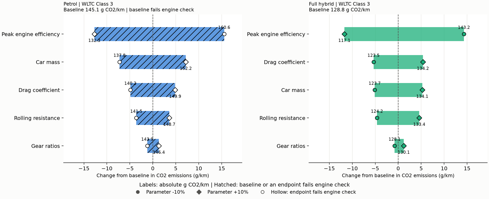
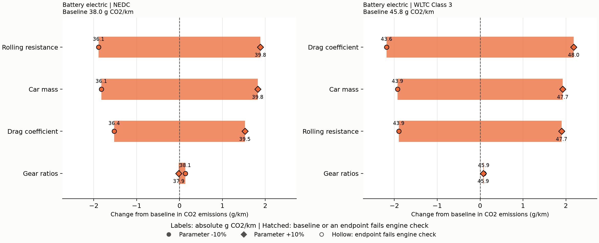
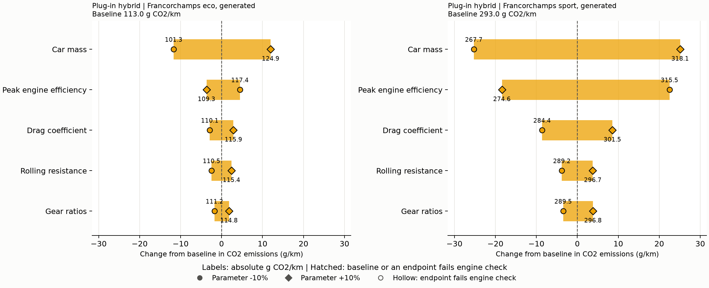
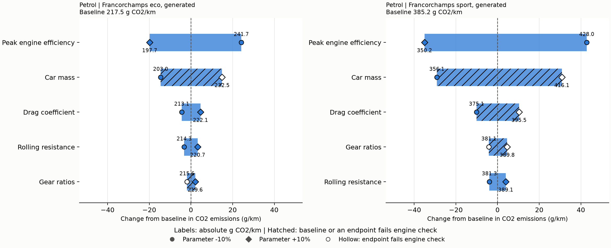

# Study B: one-factor CO2 sensitivity

## Choices recorded before the sweep

The owner approved the starter assumptions on 3 November 2026:

- Mass changes `m_vehicle` alone by ±10%; driver, machine and battery mass stay fixed. Total mass therefore changes by less than 10%.
- Engine efficiency scales `eta_max` alone by ±10%, from 0.35 to 0.315 or 0.385. The curve coefficients and rated power stay fixed. The BEV has no engine variant.
- The generated eco and sport laps remain those of the baseline petrol car. Every vehicle follows the same trace; this measures energy demand at a fixed driving task, rather than a change in lap time.

The assignment fleet, storage-loss scenario, 250 g CO2/kWh grid, charging efficiency, hybrid control and PHEV accounting stay as implemented in `pwt.sweep`. Regulatory PHEV results are the model's R101-weighted charge-depleting and charge-sustaining results, not a single electric trip.

The ±10% ranges are study assumptions, not sourced claims about achievable designs. No shared model values or course files are changed. Analysis and slides are a draft for the owner's review as personal graded work.

## Validation on 3 November 2026

After the review changes the full suite passed: **257 tests passed, 1 skipped** (the existing LibreOffice-dependent test; LibreOffice is not installed). All 16 approved EU baselines still match to one decimal. Regression checks cover refreshed numerical prose/slides, near-ties, mass definition, curve shape, interaction residuals, engine flags and French-grid accounting. Generated figures were visually checked; the PowerPoint was reopened to verify five slides and shape bounds. The original 168 runs are supplemented by 950 exploratory runs. Course files and driving-model code are unchanged; the sweep's BEV French-grid accounting helper was corrected to avoid double-counting electricity.

<!-- Generated by python -m pwt.sensitivity_report; edit the generator below this point. -->

## Reproduce the study

From the repository root:

| Step | Windows PowerShell | macOS / Linux |
|---|---|---|
| Environment | `python -m venv .venv` | `python3 -m venv .venv` |
| Install | `.\.venv\Scripts\python.exe -m pip install -r requirements-study-b.txt` | `.venv/bin/python -m pip install -r requirements-study-b.txt` |
| Test | `.\.venv\Scripts\python.exe -m pytest` | `.venv/bin/python -m pytest` |
| Regenerate | `.\.venv\Scripts\python.exe -m pwt.sensitivity_report` | `.venv/bin/python -m pwt.sensitivity_report` |

No LibreOffice is needed for this study. Reporting dependencies stay separate from Cloud. Committed figures and PowerPoint are review snapshots; replace them on regeneration rather than accumulating dated binaries. CSVs and code remain the source of results.

## Method and baseline

The approved study has 168 runs and 76 factor/car/cycle spans. Span = `abs(CO2(1.1) - CO2(0.9))`. Baseline checks stop generation if any approved EU-grid baseline changes at one decimal. Values below are g CO2/km.

| powertrain       |   NEDC |   WLTC Class 3 |   Francorchamps eco, generated |   Francorchamps sport, generated |
|:-----------------|-------:|---------------:|-------------------------------:|---------------------------------:|
| Petrol           |  134.1 |          145.1 |                          217.5 |                            385.2 |
| Battery electric |   38.0 |           45.8 |                           56.5 |                            132.2 |
| Full hybrid      |  123.7 |          128.8 |                          218.8 |                            395.2 |
| Plug-in hybrid   |   67.9 |           73.6 |                          113.0 |                            293.0 |

## Findings for owner review

WLTC engine-efficiency spans: petrol 28.3 and full hybrid 26.0 g/km (20.2% of the hybrid baseline). Fuel demand divides engine work by efficiency. Scaling eta_max changes the whole power curve; idle fuel is fixed. A large effect does not establish low cost.

BEV NEDC rolling and mass spans: 3.77 and 3.64 g/km; WLTC drag span: 4.36 g/km. Drag force grows with speed squared; mass affects acceleration, rolling and climbing work, with partial recovery. Small gaps require caution.

PHEV mass spans: eco 23.7 and sport 50.4 g/km. Mass affects both electric and fuel work; engine efficiency affects fuel conversion. Regulatory results include R101 weighting.

PHEV WLTC drag and mass spans: 8.005 and 7.959 g/km; gap 0.045 g/km. The ranking table applies the stated tie rule.

BEV WLTC gear endpoint deltas: +0.084 and +0.074 g/km (span 0.010). Hybrid sport gear deltas: +0.973 and +4.250. A small endpoint span can hide curvature. Combustion efficiency is power-based; the BEV motor map also depends on rpm. The intermediate points test this without claiming a continuous optimum.

## Rankings and near-ties

`≈` groups spans differing by **less than 2% of the largest span in that tie group**; groups are anchored to their largest member to avoid transitive ties. This is a reporting convention, not statistical confidence; close gaps may still fall outside this threshold. `†` marks a failing baseline or endpoint. The passing ranking excludes that entire comparison, never just one endpoint. BEV flags do not certify motor, battery or thermal limits.

| Car              | Cycle                          | Requested trace                                                                                   | Passing baseline and both endpoints                                                     |
|:-----------------|:-------------------------------|:--------------------------------------------------------------------------------------------------|:----------------------------------------------------------------------------------------|
| Battery electric | Francorchamps eco, generated   | Car mass > Drag coefficient > Rolling resistance > Gear ratios                                    | Car mass > Drag coefficient > Rolling resistance > Gear ratios                          |
| Battery electric | Francorchamps sport, generated | Car mass > Drag coefficient > Gear ratios > Rolling resistance                                    | Car mass > Drag coefficient > Gear ratios > Rolling resistance                          |
| Battery electric | NEDC                           | Rolling resistance > Car mass > Drag coefficient > Gear ratios                                    | Rolling resistance > Car mass > Drag coefficient > Gear ratios                          |
| Battery electric | WLTC Class 3                   | Drag coefficient > Car mass ≈ Rolling resistance > Gear ratios                                    | Drag coefficient > Car mass ≈ Rolling resistance > Gear ratios                          |
| Full hybrid      | Francorchamps eco, generated   | Peak engine efficiency > Car mass > Drag coefficient > Rolling resistance > Gear ratios           | Peak engine efficiency > Car mass > Drag coefficient > Rolling resistance > Gear ratios |
| Full hybrid      | Francorchamps sport, generated | Peak engine efficiency > Car mass > Drag coefficient > Rolling resistance > Gear ratios           | Peak engine efficiency > Car mass > Drag coefficient > Rolling resistance > Gear ratios |
| Full hybrid      | NEDC                           | Peak engine efficiency > Car mass > Rolling resistance > Drag coefficient > Gear ratios           | Peak engine efficiency > Car mass > Rolling resistance > Drag coefficient > Gear ratios |
| Full hybrid      | WLTC Class 3                   | Peak engine efficiency > Drag coefficient > Car mass > Rolling resistance > Gear ratios           | Peak engine efficiency > Drag coefficient > Car mass > Rolling resistance > Gear ratios |
| Petrol           | Francorchamps eco, generated   | Peak engine efficiency > Car mass † > Drag coefficient > Rolling resistance > Gear ratios †       | Peak engine efficiency > Drag coefficient > Rolling resistance                          |
| Petrol           | Francorchamps sport, generated | Peak engine efficiency > Car mass † > Drag coefficient † > Gear ratios † > Rolling resistance     | Peak engine efficiency > Rolling resistance                                             |
| Petrol           | NEDC                           | Peak engine efficiency > Car mass † > Rolling resistance † ≈ Drag coefficient † > Gear ratios †   | Peak engine efficiency                                                                  |
| Petrol           | WLTC Class 3                   | Peak engine efficiency † > Car mass † > Drag coefficient † > Rolling resistance † > Gear ratios † | No comparison passes the engine check                                                   |
| Plug-in hybrid   | Francorchamps eco, generated   | Car mass > Peak engine efficiency > Drag coefficient > Rolling resistance > Gear ratios           | Car mass > Peak engine efficiency > Drag coefficient > Rolling resistance > Gear ratios |
| Plug-in hybrid   | Francorchamps sport, generated | Car mass > Peak engine efficiency > Drag coefficient > Rolling resistance > Gear ratios           | Car mass > Peak engine efficiency > Drag coefficient > Rolling resistance > Gear ratios |
| Plug-in hybrid   | NEDC                           | Car mass † > Rolling resistance † ≈ Peak engine efficiency † > Drag coefficient † > Gear ratios † | No comparison passes the engine check                                                   |
| Plug-in hybrid   | WLTC Class 3                   | Drag coefficient † ≈ Car mass † > Peak engine efficiency † > Rolling resistance † > Gear ratios † | No comparison passes the engine check                                                   |

## Feasibility: petrol sport rankings are provisional

The petrol sport mass ranking uses a car that cannot follow the requested trace. All daggered comparisons are provisional. Currently flagged petrol sport endpoints:

| factor   |   scale |   short_steps |   short_kw |
|:---------|--------:|--------------:|-----------:|
| mass     |   1.100 |          1207 |      5.359 |
| drag     |   1.100 |           717 |      2.452 |
| gears    |   0.900 |           840 |      5.641 |
| gears    |   1.100 |            64 |      2.809 |

Across the original study 42 of 168 rows flag engine-power shortfalls above the model's 0.1 kW noise threshold. Flagged baselines:

| powertrain   | cycle   |   short_steps |   short_kw |
|:-------------|:--------|--------------:|-----------:|
| petrol       | wltc    |            15 |      9.159 |
| phev         | nedc    |             1 |      2.347 |
| phev         | wltc    |            34 |     13.120 |

Regulatory PHEV checks use the charge-sustaining run. Consumption uses the requested trace without clipping, as in the shared sweep. Hollow markers identify failing endpoints; hatching also includes a failing baseline. Passing is an engine-power check, not full feasibility.

## Normalized sensitivity (elasticity)

Signed central elasticity = `(CO2(1.1) - CO2(0.9)) / (0.2 * baseline)`: approximate percent CO2 change per percent parameter change. One-sided elasticities divide the endpoint's relative CO2 delta by the signed 10% parameter change. They ease comparison, but **still depend on the interval** for nonlinear responses or control thresholds. They are model responses, not achievable gains.

| powertrain   | cycle                  | factor   |   elasticity |   elasticity_low |   elasticity_high | engine_check_pass   |
|:-------------|:-----------------------|:---------|-------------:|-----------------:|------------------:|:--------------------|
| bev          | franco_eco_generated   | mass     |        0.727 |            0.683 |             0.771 | True                |
| bev          | franco_eco_generated   | drag     |        0.386 |            0.384 |             0.388 | True                |
| bev          | franco_eco_generated   | rolling  |        0.316 |            0.315 |             0.317 | True                |
| bev          | franco_eco_generated   | gears    |       -0.018 |           -0.048 |             0.011 | True                |
| bev          | franco_sport_generated | mass     |        0.830 |            0.830 |             0.831 | True                |
| bev          | franco_sport_generated | drag     |        0.299 |            0.299 |             0.299 | True                |
| bev          | franco_sport_generated | gears    |        0.237 |            0.194 |             0.281 | True                |
| bev          | franco_sport_generated | rolling  |        0.130 |            0.130 |             0.130 | True                |
| bev          | nedc                   | rolling  |        0.497 |            0.497 |             0.497 | True                |
| bev          | nedc                   | mass     |        0.480 |            0.480 |             0.480 | True                |
| bev          | nedc                   | drag     |        0.401 |            0.401 |             0.401 | True                |
| bev          | nedc                   | gears    |       -0.020 |           -0.035 |            -0.005 | True                |
| bev          | wltc                   | drag     |        0.476 |            0.476 |             0.476 | True                |
| bev          | wltc                   | mass     |        0.420 |            0.420 |             0.421 | True                |
| bev          | wltc                   | rolling  |        0.415 |            0.414 |             0.415 | True                |
| bev          | wltc                   | gears    |       -0.001 |           -0.018 |             0.016 | True                |
| hybrid       | franco_eco_generated   | engine   |       -1.010 |           -1.111 |            -0.909 | True                |
| hybrid       | franco_eco_generated   | mass     |        0.634 |            0.625 |             0.643 | True                |
| hybrid       | franco_eco_generated   | drag     |        0.225 |            0.222 |             0.229 | True                |
| hybrid       | franco_eco_generated   | rolling  |        0.181 |            0.178 |             0.185 | True                |
| hybrid       | franco_eco_generated   | gears    |        0.133 |            0.118 |             0.148 | True                |
| hybrid       | franco_sport_generated | engine   |       -1.010 |           -1.111 |            -0.909 | True                |
| hybrid       | franco_sport_generated | mass     |        0.800 |            0.715 |             0.885 | True                |
| hybrid       | franco_sport_generated | drag     |        0.257 |            0.241 |             0.272 | True                |
| hybrid       | franco_sport_generated | rolling  |        0.103 |            0.101 |             0.105 | True                |
| hybrid       | franco_sport_generated | gears    |        0.041 |           -0.025 |             0.108 | True                |
| hybrid       | nedc                   | engine   |       -1.010 |           -1.111 |            -0.909 | True                |
| hybrid       | nedc                   | mass     |        0.553 |            0.665 |             0.442 | True                |
| hybrid       | nedc                   | rolling  |        0.320 |            0.448 |             0.191 | True                |
| hybrid       | nedc                   | drag     |        0.307 |            0.348 |             0.267 | True                |
| hybrid       | nedc                   | gears    |        0.075 |           -0.018 |             0.169 | True                |
| hybrid       | wltc                   | engine   |       -1.010 |           -1.111 |            -0.909 | True                |
| hybrid       | wltc                   | drag     |        0.417 |            0.416 |             0.418 | True                |
| hybrid       | wltc                   | mass     |        0.402 |            0.397 |             0.408 | True                |
| hybrid       | wltc                   | rolling  |        0.357 |            0.358 |             0.356 | True                |
| hybrid       | wltc                   | gears    |        0.077 |            0.060 |             0.094 | True                |
| petrol       | franco_eco_generated   | engine   |       -1.010 |           -1.111 |            -0.909 | True                |
| petrol       | franco_eco_generated   | mass     |        0.678 |            0.668 |             0.687 | False               |
| petrol       | franco_eco_generated   | drag     |        0.207 |            0.202 |             0.211 | True                |
| petrol       | franco_eco_generated   | rolling  |        0.149 |            0.149 |             0.149 | True                |
| petrol       | franco_eco_generated   | gears    |        0.091 |            0.086 |             0.096 | False               |
| petrol       | franco_sport_generated | engine   |       -1.010 |           -1.111 |            -0.909 | True                |
| petrol       | franco_sport_generated | mass     |        0.778 |            0.755 |             0.801 | False               |
| petrol       | franco_sport_generated | drag     |        0.265 |            0.261 |             0.268 | False               |
| petrol       | franco_sport_generated | gears    |        0.114 |            0.107 |             0.120 | False               |
| petrol       | franco_sport_generated | rolling  |        0.101 |            0.101 |             0.102 | True                |
| petrol       | nedc                   | engine   |       -0.873 |           -0.960 |            -0.785 | True                |
| petrol       | nedc                   | mass     |        0.508 |            0.510 |             0.506 | False               |
| petrol       | nedc                   | rolling  |        0.250 |            0.250 |             0.250 | False               |
| petrol       | nedc                   | drag     |        0.249 |            0.250 |             0.248 | False               |
| petrol       | nedc                   | gears    |        0.073 |            0.070 |             0.077 | False               |
| petrol       | wltc                   | engine   |       -0.974 |           -1.072 |            -0.877 | False               |
| petrol       | wltc                   | mass     |        0.497 |            0.499 |             0.495 | False               |
| petrol       | wltc                   | drag     |        0.336 |            0.337 |             0.336 | False               |
| petrol       | wltc                   | rolling  |        0.247 |            0.247 |             0.248 | False               |
| petrol       | wltc                   | gears    |        0.087 |            0.083 |             0.091 | False               |
| phev         | franco_eco_generated   | mass     |        1.048 |            1.036 |             1.060 | True                |
| phev         | franco_eco_generated   | engine   |       -0.361 |           -0.397 |            -0.325 | True                |
| phev         | franco_eco_generated   | drag     |        0.256 |            0.254 |             0.257 | True                |
| phev         | franco_eco_generated   | rolling  |        0.215 |            0.216 |             0.215 | True                |
| phev         | franco_eco_generated   | gears    |        0.157 |            0.153 |             0.161 | True                |
| phev         | franco_sport_generated | mass     |        0.860 |            0.863 |             0.857 | True                |
| phev         | franco_sport_generated | engine   |       -0.698 |           -0.768 |            -0.628 | True                |
| phev         | franco_sport_generated | drag     |        0.293 |            0.294 |             0.292 | True                |
| phev         | franco_sport_generated | rolling  |        0.129 |            0.129 |             0.129 | True                |
| phev         | franco_sport_generated | gears    |        0.124 |            0.118 |             0.130 | True                |
| phev         | nedc                   | mass     |        0.646 |            0.643 |             0.649 | False               |
| phev         | nedc                   | rolling  |        0.494 |            0.510 |             0.479 | False               |
| phev         | nedc                   | engine   |       -0.493 |           -0.542 |            -0.444 | False               |
| phev         | nedc                   | drag     |        0.386 |            0.385 |             0.387 | False               |
| phev         | nedc                   | gears    |        0.047 |            0.060 |             0.034 | False               |
| phev         | wltc                   | drag     |        0.544 |            0.540 |             0.548 | False               |
| phev         | wltc                   | mass     |        0.541 |            0.535 |             0.547 | False               |
| phev         | wltc                   | engine   |       -0.515 |           -0.567 |            -0.464 | False               |
| phev         | wltc                   | rolling  |        0.472 |            0.467 |             0.477 | False               |
| phev         | wltc                   | gears    |        0.038 |            0.035 |             0.041 | False               |

## French-grid PHEV comparison

Use the sweep's co2_fr at the existing 73 g/kWh assumption, with the same engine flags and tie convention. Compare with the EU-grid ranking above. Full spans and elasticities: [French CSV](study-b-swings-fr.csv).

| Car            | Cycle                          | Requested trace                                                                                   | Passing baseline and both endpoints                                                     |
|:---------------|:-------------------------------|:--------------------------------------------------------------------------------------------------|:----------------------------------------------------------------------------------------|
| Plug-in hybrid | Francorchamps eco, generated   | Car mass > Peak engine efficiency > Gear ratios ≈ Drag coefficient > Rolling resistance           | Car mass > Peak engine efficiency > Gear ratios ≈ Drag coefficient > Rolling resistance |
| Plug-in hybrid | Francorchamps sport, generated | Car mass > Peak engine efficiency > Drag coefficient > Rolling resistance > Gear ratios           | Car mass > Peak engine efficiency > Drag coefficient > Rolling resistance > Gear ratios |
| Plug-in hybrid | NEDC                           | Car mass † > Peak engine efficiency † > Rolling resistance † > Drag coefficient † > Gear ratios † | No comparison passes the engine check                                                   |
| Plug-in hybrid | WLTC Class 3                   | Peak engine efficiency † > Car mass † ≈ Drag coefficient † > Rolling resistance † > Gear ratios † | No comparison passes the engine check                                                   |

The BEV French-grid accounting helper was corrected during these checks: its reported CO2 already includes electricity and must not be added again to the French electricity term. French BEV CO2 is now its battery energy times the French grid intensity, including charger loss. EU-grid baselines, driving physics and PHEV accounting are unchanged.

## Research extensions (exploratory)

These supplement the approved fixed-trace study. They do not establish a re-tuned design, achievable technology package or economic optimum.

### Intermediate points and gear curvature

All factors add ±5%; gears also add ±2.5% and ±7.5%. Scale 1.0 is the baseline. The lowest sampled gear result below includes flagged points explicitly; it establishes neither a continuous minimum nor a feasible optimum. Full points: [intermediate CSV](study-b-intermediate.csv). A sampled gear setting improves on baseline in 14 of 16 car/cycle combinations, before feasibility filtering. The table retains the exact sampled scales and flags.

| Car    | Cycle                  |   Best sampled ratio scale |   Change (g/km) |   Short steps |
|:-------|:-----------------------|---------------------------:|----------------:|--------------:|
| petrol | nedc                   |                     0.9000 |         -0.9338 |             1 |
| petrol | wltc                   |                     0.9000 |         -1.2022 |            41 |
| petrol | franco_eco_generated   |                     0.9000 |         -1.8708 |            89 |
| petrol | franco_sport_generated |                     0.9000 |         -4.1221 |           840 |
| bev    | nedc                   |                     1.0750 |         -0.0245 |             0 |
| bev    | wltc                   |                     1.0000 |          0.0000 |             0 |
| bev    | franco_eco_generated   |                     1.0250 |         -0.0158 |             0 |
| bev    | franco_sport_generated |                     0.9000 |         -2.5588 |             0 |
| hybrid | nedc                   |                     1.0000 |          0.0000 |             0 |
| hybrid | wltc                   |                     0.9000 |         -0.7707 |             0 |
| hybrid | franco_eco_generated   |                     0.9000 |         -2.5930 |             0 |
| hybrid | franco_sport_generated |                     0.9500 |         -0.8788 |             0 |
| phev   | nedc                   |                     0.9000 |         -0.4089 |             1 |
| phev   | wltc                   |                     0.9000 |         -0.2558 |            63 |
| phev   | franco_eco_generated   |                     0.9000 |         -1.7299 |             0 |
| phev   | franco_sport_generated |                     0.9000 |         -3.4590 |             0 |

### Total mass versus body mass

The alternative changes body mass enough to move total mass by ±10%, keeping driver, machine, battery and capacities fixed. It is a stronger body perturbation for electrified cars, not a physical lightweighting design. Only the mass span is replaced in the ranking (g/km).

| Car    | Cycle                  |   Body span |   Total span | Total-mass ranking                                                                                |
|:-------|:-----------------------|------------:|-------------:|:--------------------------------------------------------------------------------------------------|
| petrol | nedc                   |      13.614 |       14.465 | Peak engine efficiency > Car mass † > Rolling resistance † ≈ Drag coefficient † > Gear ratios †   |
| petrol | wltc                   |      14.419 |       15.320 | Peak engine efficiency † > Car mass † > Drag coefficient † > Rolling resistance † > Gear ratios † |
| petrol | franco_eco_generated   |      29.474 |       31.339 | Peak engine efficiency > Car mass † > Drag coefficient > Rolling resistance > Gear ratios †       |
| petrol | franco_sport_generated |      59.949 |       63.713 | Peak engine efficiency > Car mass † > Drag coefficient † > Gear ratios † > Rolling resistance     |
| bev    | nedc                   |       3.645 |        4.563 | Car mass > Rolling resistance > Drag coefficient > Gear ratios                                    |
| bev    | wltc                   |       3.852 |        4.822 | Car mass > Drag coefficient > Rolling resistance > Gear ratios                                    |
| bev    | franco_eco_generated   |       8.207 |       10.247 | Car mass > Drag coefficient > Rolling resistance > Gear ratios                                    |
| bev    | franco_sport_generated |      21.954 |       27.477 | Car mass > Drag coefficient > Gear ratios > Rolling resistance                                    |
| hybrid | nedc                   |      13.693 |       14.100 | Peak engine efficiency > Car mass > Rolling resistance > Drag coefficient > Gear ratios           |
| hybrid | wltc                   |      10.370 |       12.209 | Peak engine efficiency > Car mass > Drag coefficient > Rolling resistance > Gear ratios           |
| hybrid | franco_eco_generated   |      27.749 |       31.840 | Peak engine efficiency > Car mass > Drag coefficient > Rolling resistance > Gear ratios           |
| hybrid | franco_sport_generated |      63.246 |       72.795 | Peak engine efficiency > Car mass > Drag coefficient > Rolling resistance > Gear ratios           |
| phev   | nedc                   |       8.768 |       10.681 | Car mass † > Rolling resistance † ≈ Peak engine efficiency † > Drag coefficient † > Gear ratios † |
| phev   | wltc                   |       7.959 |        9.769 | Car mass † > Drag coefficient † > Peak engine efficiency † > Rolling resistance † > Gear ratios † |
| phev   | franco_eco_generated   |      23.673 |       28.952 | Car mass > Peak engine efficiency > Drag coefficient > Rolling resistance > Gear ratios           |
| phev   | franco_sport_generated |      50.366 |       61.444 | Car mass > Peak engine efficiency > Drag coefficient > Rolling resistance > Gear ratios           |

### Engine curve shape

Menus in workbooks 10, 15 and 35 are read by label and verified to agree. `shape_only` retains the assignment eta_max multiplier and changes a1/a2/a3; `workbook_curve` also uses the menu's eta_max. The old-engine peak change is thereby separated from the part-load shape. These categorical alternatives are not ±10% changes and cannot be inserted in the equal-range ranking. Deltas test the engine response beyond height scaling; they do not establish a universal ranking. The largest absolute shape-only delta is +59.611 g/km for petrol, nedc, atkinson. The normalized demand P/Pmax samples different portions of the polynomial on different cycles; a curve name alone is not evidence of an efficiency improvement.

| curve     |   eta_max |      a1 |     a2 |     a3 |
|:----------|----------:|--------:|-------:|-------:|
| downsized |    0.3500 | -0.3867 | 0.6285 | 0.7516 |
| atkinson  |    0.3500 | -1.0778 | 1.7543 | 0.3097 |
| old       |    0.2500 | -1.0778 | 1.7543 | 0.3097 |

| Car    | Cycle                  | Experiment     | Curve     |   Change (g/km) |   Short steps |
|:-------|:-----------------------|:---------------|:----------|----------------:|--------------:|
| petrol | nedc                   | shape_only     | downsized |           0.000 |             0 |
| petrol | nedc                   | workbook_curve | downsized |           0.000 |             0 |
| petrol | nedc                   | shape_only     | atkinson  |          59.611 |             0 |
| petrol | nedc                   | workbook_curve | atkinson  |          59.611 |             0 |
| petrol | nedc                   | shape_only     | old       |          59.611 |             0 |
| petrol | nedc                   | workbook_curve | old       |         129.784 |             0 |
| petrol | wltc                   | shape_only     | downsized |           0.000 |            15 |
| petrol | wltc                   | workbook_curve | downsized |           0.000 |            15 |
| petrol | wltc                   | shape_only     | atkinson  |          49.466 |            15 |
| petrol | wltc                   | workbook_curve | atkinson  |          49.466 |            15 |
| petrol | wltc                   | shape_only     | old       |          49.466 |            15 |
| petrol | wltc                   | workbook_curve | old       |         125.220 |            15 |
| petrol | franco_eco_generated   | shape_only     | downsized |           0.000 |             0 |
| petrol | franco_eco_generated   | workbook_curve | downsized |           0.000 |             0 |
| petrol | franco_eco_generated   | shape_only     | atkinson  |          22.151 |             0 |
| petrol | franco_eco_generated   | workbook_curve | atkinson  |          22.151 |             0 |
| petrol | franco_eco_generated   | shape_only     | old       |          22.151 |             0 |
| petrol | franco_eco_generated   | workbook_curve | old       |         118.017 |             0 |
| petrol | franco_sport_generated | shape_only     | downsized |           0.000 |             0 |
| petrol | franco_sport_generated | workbook_curve | downsized |           0.000 |             0 |
| petrol | franco_sport_generated | shape_only     | atkinson  |          -1.769 |             0 |
| petrol | franco_sport_generated | workbook_curve | atkinson  |          -1.769 |             0 |
| petrol | franco_sport_generated | shape_only     | old       |          -1.769 |             0 |
| petrol | franco_sport_generated | workbook_curve | old       |         151.608 |             0 |
| hybrid | nedc                   | shape_only     | downsized |           0.000 |             0 |
| hybrid | nedc                   | workbook_curve | downsized |           0.000 |             0 |
| hybrid | nedc                   | shape_only     | atkinson  |           9.590 |             0 |
| hybrid | nedc                   | workbook_curve | atkinson  |           9.590 |             0 |
| hybrid | nedc                   | shape_only     | old       |           9.590 |             0 |
| hybrid | nedc                   | workbook_curve | old       |          62.907 |             0 |
| hybrid | wltc                   | shape_only     | downsized |           0.000 |             0 |
| hybrid | wltc                   | workbook_curve | downsized |           0.000 |             0 |
| hybrid | wltc                   | shape_only     | atkinson  |           8.062 |             0 |
| hybrid | wltc                   | workbook_curve | atkinson  |           8.062 |             0 |
| hybrid | wltc                   | shape_only     | old       |           8.062 |             0 |
| hybrid | wltc                   | workbook_curve | old       |          62.822 |             0 |
| hybrid | franco_eco_generated   | shape_only     | downsized |           0.000 |             0 |
| hybrid | franco_eco_generated   | workbook_curve | downsized |           0.000 |             0 |
| hybrid | franco_eco_generated   | shape_only     | atkinson  |          13.355 |             0 |
| hybrid | franco_eco_generated   | workbook_curve | atkinson  |          13.355 |             0 |
| hybrid | franco_eco_generated   | shape_only     | old       |          13.355 |             0 |
| hybrid | franco_eco_generated   | workbook_curve | old       |         106.234 |             0 |
| hybrid | franco_sport_generated | shape_only     | downsized |           0.000 |             0 |
| hybrid | franco_sport_generated | workbook_curve | downsized |           0.000 |             0 |
| hybrid | franco_sport_generated | shape_only     | atkinson  |          -0.210 |             0 |
| hybrid | franco_sport_generated | workbook_curve | atkinson  |          -0.210 |             0 |
| hybrid | franco_sport_generated | shape_only     | old       |          -0.210 |             0 |
| hybrid | franco_sport_generated | workbook_curve | old       |         157.776 |             0 |
| phev   | nedc                   | shape_only     | downsized |           0.000 |             1 |
| phev   | nedc                   | workbook_curve | downsized |           0.000 |             1 |
| phev   | nedc                   | shape_only     | atkinson  |          15.301 |             1 |
| phev   | nedc                   | workbook_curve | atkinson  |          15.301 |             1 |
| phev   | nedc                   | shape_only     | old       |          15.301 |             1 |
| phev   | nedc                   | workbook_curve | old       |          34.672 |             1 |
| phev   | wltc                   | shape_only     | downsized |           0.000 |            34 |
| phev   | wltc                   | workbook_curve | downsized |           0.000 |            34 |
| phev   | wltc                   | shape_only     | atkinson  |          11.331 |            34 |
| phev   | wltc                   | workbook_curve | atkinson  |          11.331 |            34 |
| phev   | wltc                   | shape_only     | old       |          11.331 |            34 |
| phev   | wltc                   | workbook_curve | old       |          30.878 |            34 |
| phev   | franco_eco_generated   | shape_only     | downsized |           0.000 |             0 |
| phev   | franco_eco_generated   | workbook_curve | downsized |           0.000 |             0 |
| phev   | franco_eco_generated   | shape_only     | atkinson  |           9.138 |             0 |
| phev   | franco_eco_generated   | workbook_curve | atkinson  |           9.138 |             0 |
| phev   | franco_eco_generated   | shape_only     | old       |           9.138 |             0 |
| phev   | franco_eco_generated   | workbook_curve | old       |          28.939 |             0 |
| phev   | franco_sport_generated | shape_only     | downsized |           0.000 |             0 |
| phev   | franco_sport_generated | workbook_curve | downsized |           0.000 |             0 |
| phev   | franco_sport_generated | shape_only     | atkinson  |          15.584 |             0 |
| phev   | franco_sport_generated | workbook_curve | atkinson  |          15.584 |             0 |
| phev   | franco_sport_generated | shape_only     | old       |          15.584 |             0 |
| phev   | franco_sport_generated | workbook_curve | old       |         102.814 |             0 |

### Technology-inspired improvement ranges

Body mass −5%/−10%; drag −10%/−20%; rolling −10%/−20%; engine eta_max +5%/+10%; gears −5%/+5%. DOE lightweighting and EPA's 2016 technology assessment motivate the road-load ranges ([sources](sources.md#study-b-extension-ranges)). The translation from vehicle mass to body mass and both engine increments are study assumptions; engine multipliers remain inside the assignment's 20–40% range. Gear increments have no sourced universal feasible range and are explicitly exploratory. These are screening ranges, not validated achievable limits for these cars, a symmetric uncertainty interval or a cost ranking. No tyre-grip, safety, cost or re-tuning model is available. The largest sampled saving among scenarios passing the engine check is shown per car/cycle; groups with a failing baseline are omitted. All endpoints: [ranges CSV](study-b-ranges.csv).

| Car    | Cycle                  | Factor   |   Scale |   CO2 saving (g/km) | Engine check passes   |
|:-------|:-----------------------|:---------|--------:|--------------------:|:----------------------|
| bev    | franco_eco_generated   | drag     |   0.800 |               4.339 | True                  |
| bev    | franco_sport_generated | mass     |   0.900 |              10.965 | True                  |
| bev    | nedc                   | rolling  |   0.800 |               3.765 | True                  |
| bev    | wltc                   | drag     |   0.800 |               4.360 | True                  |
| hybrid | franco_eco_generated   | engine   |   1.100 |              19.895 | True                  |
| hybrid | franco_sport_generated | engine   |   1.100 |              35.925 | True                  |
| hybrid | nedc                   | engine   |   1.100 |              11.246 | True                  |
| hybrid | wltc                   | engine   |   1.100 |              11.713 | True                  |
| petrol | franco_eco_generated   | engine   |   1.100 |              19.774 | True                  |
| petrol | franco_sport_generated | engine   |   1.100 |              35.019 | True                  |
| petrol | nedc                   | engine   |   1.100 |              10.529 | True                  |
| phev   | franco_eco_generated   | mass     |   0.900 |              11.697 | True                  |
| phev   | franco_sport_generated | mass     |   0.900 |              25.272 | True                  |

### Per-vehicle regenerated laps

Every petrol/hybrid variant receives its own generated lap and gears, then the engine shortfall check. Speed and lap time change with CO2, so the driving task differs. Hybrids use the generator's combustion-engine-only acceleration envelope, not optimal combined power. Only comparisons whose baseline and both endpoints pass are ranked below; this does not establish full vehicle feasibility. BEV regeneration is omitted because the shared generator lacks its motor/battery capability model. CSV rows retain lap time and residual shortfalls.

Changes in the strictly highest-span factor: Plug-in hybrid on Francorchamps sport, generated: Car mass → Peak engine efficiency. This shows sensitivity to the driving-task assumption; it is not an independent technology benefit.

| Car    | Cycle                  | Fixed trace                                                                                   | Regenerated, passing comparisons                                                        |
|:-------|:-----------------------|:----------------------------------------------------------------------------------------------|:----------------------------------------------------------------------------------------|
| petrol | franco_eco_generated   | Peak engine efficiency > Car mass † > Drag coefficient > Rolling resistance > Gear ratios †   | Peak engine efficiency > Car mass > Drag coefficient > Rolling resistance > Gear ratios |
| petrol | franco_sport_generated | Peak engine efficiency > Car mass † > Drag coefficient † > Gear ratios † > Rolling resistance | Peak engine efficiency > Car mass > Drag coefficient > Rolling resistance > Gear ratios |
| hybrid | franco_eco_generated   | Peak engine efficiency > Car mass > Drag coefficient > Rolling resistance > Gear ratios       | Peak engine efficiency > Car mass > Drag coefficient > Rolling resistance > Gear ratios |
| hybrid | franco_sport_generated | Peak engine efficiency > Car mass > Drag coefficient > Rolling resistance > Gear ratios       | Peak engine efficiency > Car mass > Drag coefficient > Rolling resistance > Gear ratios |
| phev   | franco_eco_generated   | Car mass > Peak engine efficiency > Drag coefficient > Rolling resistance > Gear ratios       | Car mass > Peak engine efficiency > Drag coefficient > Rolling resistance > Gear ratios |
| phev   | franco_sport_generated | Car mass > Peak engine efficiency > Drag coefficient > Rolling resistance > Gear ratios       | Peak engine efficiency > Car mass > Drag coefficient > Rolling resistance > Gear ratios |

### Two-factor interactions

A 3×3 grid (0.9, 1.0, 1.1) tests mass × drag and mass × gears for all powertrains, plus mass × engine efficiency for hybrids, on WLTC and sport. Interaction = C(m,x) − C(m,1) − C(1,x) + C(1,1), in g/km; zero is additive at that sampled point. Passing requires all four terms to pass the engine check; NaN means none passed. Original traces and strategies stay fixed.

| Car    | Cycle                  | Pair          |   Largest |interaction| (g/km) |   Largest passing |interaction| |   Failing points |
|:-------|:-----------------------|:--------------|-------------------------------:|--------------------------------:|-----------------:|
| petrol | wltc                   | mass × drag   |                          0.053 |                         nan     |                9 |
| petrol | franco_sport_generated | mass × drag   |                          0.598 |                           0.454 |                5 |
| petrol | wltc                   | mass × gears  |                          0.119 |                         nan     |                9 |
| petrol | franco_sport_generated | mass × gears  |                          0.845 |                           0.000 |                7 |
| bev    | wltc                   | mass × drag   |                          0.003 |                           0.003 |                0 |
| bev    | franco_sport_generated | mass × drag   |                          0.003 |                           0.003 |                0 |
| bev    | wltc                   | mass × gears  |                          0.010 |                           0.010 |                0 |
| bev    | franco_sport_generated | mass × gears  |                          0.275 |                           0.275 |                0 |
| hybrid | wltc                   | mass × drag   |                          0.134 |                           0.134 |                0 |
| hybrid | franco_sport_generated | mass × drag   |                          2.911 |                           2.911 |                1 |
| hybrid | wltc                   | mass × gears  |                          0.340 |                           0.340 |                0 |
| hybrid | franco_sport_generated | mass × gears  |                          4.710 |                           4.710 |                1 |
| hybrid | wltc                   | mass × engine |                          0.584 |                           0.584 |                0 |
| hybrid | franco_sport_generated | mass × engine |                          3.887 |                           3.887 |                0 |
| phev   | wltc                   | mass × drag   |                          0.177 |                         nan     |                9 |
| phev   | franco_sport_generated | mass × drag   |                          0.118 |                           0.118 |                0 |
| phev   | wltc                   | mass × gears  |                          0.064 |                         nan     |                9 |
| phev   | franco_sport_generated | mass × gears  |                          0.396 |                           0.396 |                0 |
| phev   | wltc                   | mass × engine |                          0.339 |                         nan     |                9 |
| phev   | franco_sport_generated | mass × engine |                          2.808 |                           2.808 |                0 |

## Status, limits and next step

**Technical feedback implemented; interpretation and slides remain an owner-review draft. No final approval or merge is implied.** The owner should confirm the conclusions and adapt the presentation before submission.

The approved study keeps body-only mass, fixed laps, peak-only efficiency and unchanged strategies. Separate extensions test those choices; they do not change shared model code or course files. Technology-inspired ranges answer a different question from equal ±10%. Costs and trade-offs are outside the model. Next: validate ranges and hybrid/BEV capability, then refine sampled minima and interactions on comparable feasible tasks.

## Deliverables

- [Original runs](study-b-results.csv), [EU spans/elasticities](study-b-swings.csv), [French spans](study-b-swings-fr.csv)
- [Intermediate points](study-b-intermediate.csv), [assumptions](study-b-assumptions.csv), [curves](study-b-curves.csv)
- [Ranges](study-b-ranges.csv), [regenerated laps](study-b-regenerated.csv), [interactions](study-b-interactions.csv)
- [Five-slide draft](study-b-slides.pptx)
- PDF: [combustion](study-b-combustion.pdf), [electric](study-b-electric.pdf), [plug-in](study-b-plugin.pdf), [provisional petrol](study-b-provisional.pdf)

Provenance: [equations](model-equations.md), [sizing](phase-3-sizing.md), [sources](sources.md).
