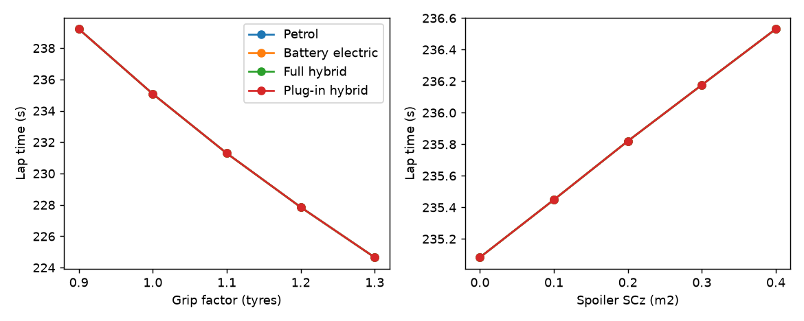
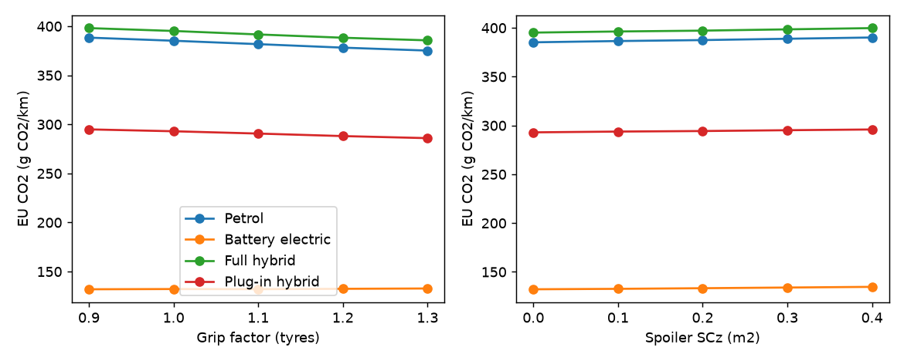

# Study C: cornering speed

**Status: DRAFT by Claude, for the owner to review.** The choices below are provisional
assumptions, not decisions. Regenerate with `python -m pwt.cornering`, which writes
`study-c-results.csv` and the figures below (the figures need `requirements-study-c.txt`).

## Choices (written before running)

| Choice | Value | Basis |
|---|---|---|
| Template corner speeds | Treated as set at the grip limit of μ₀ | Simplification. La Source's outline radius is ~35 m at 40 km/h, which implies μ≈0.36, so the template may be well below the limit. This is the study's biggest doubt. |
| Reference grip μ₀ | 0.7 | Course sheet `11 Good trajectory speed.pdf` uses γ = 0.7 g. |
| Corner radii | Inferred, R = v²/(μ₀g): 18 m (La Source, last corner), 47 m (×7), 72 m, 112 m (×2) | Outline-based estimates from `pwt/trackmap.py` not used yet. |
| Spoiler downforce | SCz = 0.1 to 0.4 m² | ASSUMPTION, unsourced. |
| Spoiler drag | added SCx = SCz / 4 (lift-to-drag 4) | ASSUMPTION, unsourced. |
| Spoiler mass | 40 kg per m² of SCz (3 to 16 kg) | ASSUMPTION, unsourced. |
| Lap | Generated by the petrol car (as in `pwt.sweep.cycles`), driven by every car. Spoiler variants use the spoiler petrol car for the lap and the spoiler version of each car in `sweep`. | Repo convention, plan Task 7. |

## Results (sport lap, "storage losses" scenario)

Baseline check passes: 235.1 s and 385.2 g CO2/km for petrol. `short_steps` is 0 everywhere.

| Case | Lap time | Petrol g CO2/km |
|---|---|---|
| Grip ×0.9 | 239.2 s | 388.4 |
| Grip ×1.0 (baseline) | 235.1 s | 385.2 |
| Grip ×1.1 | 231.3 s | 381.7 |
| Grip ×1.3 | 224.7 s | 375.2 |
| Spoiler SCz 0.2 | 235.8 s | 387.5 |
| Spoiler SCz 0.4 | 236.5 s | 390.2 |

- **Tyres:** each 0.1 step in grip factor saves 3.2 to 4.1 s and 2.7 to 3.6 g/km (petrol, hybrid), through less braking and re-accelerating. Corner speed rises with √grip.
- **Spoiler:** it makes both lap time and CO2 worse. At these speeds downforce is tiny: at SCz 0.4 m² the fastest corner (100 km/h) gains 0.7 km/h and the slow ones nothing, while the drag and mass cost on every straight. Aero only pays at high speed, and the template corners are all at 100 km/h or below.
- **Cars:** the electric car (about 132 g/km) is nearly flat with grip, since regeneration recovers much of the braking; the hybrid and plug-in follow the petrol trend. Rankings between cars do not change.

## Limits

- Radii are inferred from the template speeds, not measured, and rest on μ₀ = 0.7.
- One line through each corner.
- Braking is fixed at 0.6 g; more grip would probably allow harder braking, favouring the tyre case.
- Only the 12 listed corners change; corners 16 and 17 stay straights.
- The spoiler numbers are unsourced assumptions and the conclusion depends on them. A much larger SCz (or a higher-speed track) would change it. They are listed in `docs/sources.md` as unsourced assumptions; no source was found.

## Not done (owner's)

Task 8 slides, and review of every choice above. Open question for discussion: the μ≈0.36 mismatch at La Source.
