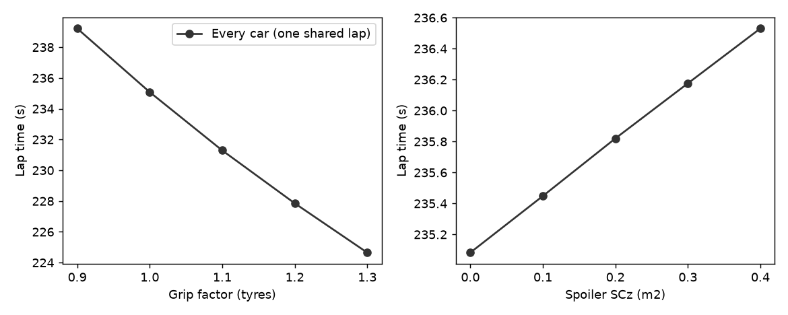
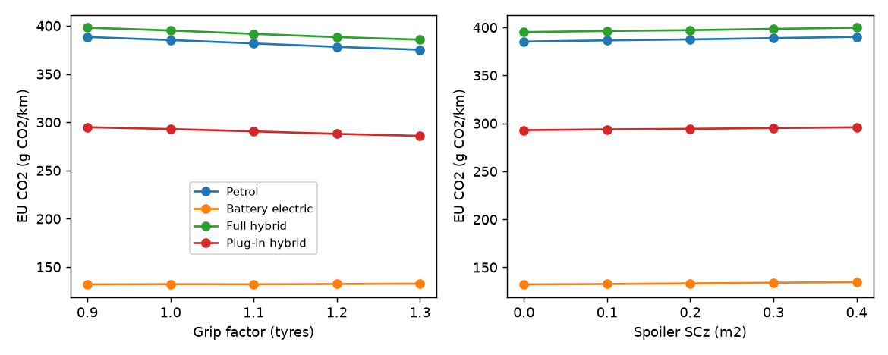

# Study C: cornering speed

**Status: DRAFT by Claude (second pass), for the owner to review.** Every choice, comparison
rule and description below is provisional for the owner to accept or replace. Regenerate all
saved CSVs and figures with `.venv/bin/python -m pwt.cornering` (figures need
`requirements-study-c.txt`).

## Choices (provisional, for the owner to review)

| Choice | Provisional value | Basis |
|---|---|---|
| Template corner speeds | Default: treated as set at μ₀ = 0.7 (inferred radii). Alternative: estimated from the circuit outline (`--radius-method outline`). | The outline radii imply μ from 0.41 to 0.94 across the 12 corners (table below), so the template speeds are not at one uniform grip limit. Inferred radii remain the default so the plan baseline reproduces exactly. |
| Reference grip μ₀ | 0.7 | Course sheet `11 Good trajectory speed.pdf` uses γ = 0.7 g. |
| Corner radii | Default inferred: R = v² / (μ₀ g) = 18.0 m to 112.4 m. Alternative outline: 3-vertex circumradius from `pwt/trackmap.py` and `data/track/spa-francorchamps.geojson` = 13.3 m to 102.5 m. | Selectable in `pwt.cornering` via `radius_method="inferred"` or `"outline"`. |
| Spoiler downforce | SCz = 0.1 to 0.4 m² | Provisional range bracketed by published road-car and track-day rear wings (see `docs/sources.md`). |
| Spoiler drag | Added SCx = SCz / 4 (lift-to-drag 4) | ASSUMPTION, unsourced for this vehicle body (see `docs/sources.md`). |
| Spoiler mass | 40 kg per m² of SCz (4 to 16 kg) | ASSUMPTION, linear scaling unsourced; 4 to 16 kg brackets a 6.8 kg carbon wing kit up to a larger aero assembly (see `docs/sources.md`). |
| Like-for-like rule | Matched on lap time (`match_by="lap_time"`) | Provisional choice for the owner. `MATCH_RULES` in `pwt/cornering.py` is structured so another rule (average corner-speed gain, or one reference corner) can be added. |
| Lap and vehicles | Generated by Petrol (`franco_sport_generated`, "storage losses" scenario), driven by Petrol, Battery electric, Full hybrid and Plug-in hybrid. Spoiler variants apply added drag and mass to both the lap-generating car and every car in `sweep`. | Repo convention and plan Task 7. |

## Corner radii and implied grip on the circuit outline

The outline in `data/track/spa-francorchamps.geojson` (`bacinger/f1-circuits`) is coarse:
152 unique vertices over 6978.4 m, with vertex spacing from 8.4 m to 377.0 m (median 21.3 m,
mean 45.9 m). It gives a single centreline with no track width or banking, and corner 15 at
5100 m has no anchor in `pwt/trackmap.py` (its outline position is linearly interpolated
between Stavelot and Bus Stop).

For each of the 12 set-speed corners, the outline method maps the model distance through
`pwt.trackmap.ANCHORS` and takes the tightest 3-vertex circumradius within ±120 m. On tight
hairpins, a 3-vertex centreline radius depends strongly on vertex spacing and sits below a
wider racing line across track width (which is why La Source reads 13.3 m here rather than
the ~35 m rough figure noted in the plan).

| Distance (m) | Landmark | Template speed (km/h) | Inferred R (m) | Outline R (m) | Implied μ on outline | Outline speed at μ₀ = 0.7 (km/h) |
|---|---|---|---|---|---|---|
| 220 | La Source | 40.0 | 18.0 | 13.3 | 0.94 | 34.5 |
| 890 | — | 100.0 | 112.4 | 102.5 | 0.77 | 95.5 |
| 1130 | — | 100.0 | 112.4 | 92.3 | 0.85 | 90.6 |
| 2200 | Les Combes | 65.0 | 47.5 | 36.7 | 0.91 | 57.1 |
| 2470 | — | 65.0 | 47.5 | 45.4 | 0.73 | 63.6 |
| 2870 | Bruxelles | 65.0 | 47.5 | 38.3 | 0.87 | 58.4 |
| 3110 | — | 65.0 | 47.5 | 43.8 | 0.76 | 62.5 |
| 3600 | Pouhon | 65.0 | 47.5 | 80.4 | 0.41 | 84.6 |
| 4280 | Fagnes | 65.0 | 47.5 | 68.9 | 0.48 | 78.3 |
| 4740 | Stavelot | 65.0 | 47.5 | 42.6 | 0.78 | 61.6 |
| 5100 | — | 80.0 | 71.9 | 95.1 | 0.53 | 92.0 |
| 6540 | Bus Stop | 40.0 | 18.0 | 14.1 | 0.89 | 35.4 |

Full table: `docs/study-c-corners.csv`.

## Results (Francorchamps sport, generated — "storage losses" scenario)

Baseline check passes: 235.1 s and 385.2 g CO2/km for Petrol across the 12 set-speed corners.
`short_steps` is 0 everywhere (every Petrol, Battery electric, Full hybrid and Plug-in hybrid
run in `study-c-results.csv`, `study-c-results-outline.csv` and `study-c-comparison.csv` is
feasible).

### Default method: inferred radii (`docs/study-c-results.csv`)

| Case | Lap time (s) | Petrol (g CO2/km) | Battery electric (g CO2/km) | Full hybrid (g CO2/km) | Plug-in hybrid (g CO2/km) |
|---|---|---|---|---|---|
| Grip ×0.9 | 239.2 | 388.4 | 131.9 | 398.1 | 294.9 |
| Grip ×1.0 (baseline) | 235.1 | 385.2 | 132.2 | 395.2 | 293.0 |
| Grip ×1.1 | 231.3 | 381.7 | 132.1 | 391.6 | 290.6 |
| Grip ×1.2 | 227.9 | 378.2 | 132.4 | 388.3 | 288.1 |
| Grip ×1.3 | 224.7 | 375.2 | 132.7 | 385.6 | 286.0 |
| Spoiler SCz 0.1 m² | 235.4 | 386.5 | 132.6 | 396.3 | 293.8 |
| Spoiler SCz 0.2 m² | 235.8 | 387.5 | 133.3 | 397.2 | 294.3 |
| Spoiler SCz 0.3 m² | 236.2 | 388.9 | 134.0 | 398.5 | 295.2 |
| Spoiler SCz 0.4 m² | 236.5 | 390.2 | 134.7 | 399.8 | 295.9 |

- **Tyres:** each 0.1 step in grip factor saves 3.2 to 4.1 s and 2.7 to 3.6 g CO2/km (Petrol,
  Full hybrid), through less braking into corners and less rebuilding of speed out of them.
- **Spoiler:** under these assumptions, both lap time and EU CO2 worsen with SCz. Corner
  speeds are 40 to 100 km/h, so downforce adds little speed in corners while drag and mass
  penalise every straight.
- **Powertrains:** Battery electric (about 132 g CO2/km EU, 38.6 g CO2/km France at baseline)
  is nearly flat with tyre grip because regeneration recovers braking energy, but still rises
  with spoiler drag (+2.5 g CO2/km EU at SCz 0.4 m²). Full hybrid and Plug-in hybrid follow
  the Petrol direction. Powertrain rankings do not change.

### Alternative method: outline radii (`docs/study-c-results-outline.csv`)

| Case | Lap time (s) | Petrol (g CO2/km) | Battery electric (g CO2/km) | Full hybrid (g CO2/km) | Plug-in hybrid (g CO2/km) |
|---|---|---|---|---|---|
| Grip ×0.9 | 239.2 | 387.1 | 131.4 | 396.4 | 293.5 |
| Grip ×1.0 (outline μ₀ = 0.7) | 235.4 | 382.2 | 131.3 | 391.8 | 289.9 |
| Grip ×1.3 | 224.7 | 372.6 | 131.9 | 383.0 | 283.3 |
| Spoiler SCz 0.2 m² | 236.1 | 384.8 | 132.7 | 394.5 | 291.4 |
| Spoiler SCz 0.4 m² | 236.9 | 387.3 | 134.1 | 396.9 | 292.9 |

At μ₀ = 0.7, the outline radii give a slightly slower Petrol baseline lap (235.4 s vs 235.1 s)
and lower EU CO2 (382.2 vs 385.2 g CO2/km), because faster mid-speed corners (Pouhon, Fagnes)
reduce braking while tighter hairpins (La Source, Bus Stop) add a fraction of a second. The
response to both tyres and spoiler keeps the same direction.

## Like-for-like comparison: spoiler versus tyres (`docs/study-c-comparison.csv`)

**Provisional matching rule:** matched on lap time (`match_by="lap_time"`). For each spoiler
size, `pwt.cornering.spoiler_vs_tyres` finds the tyre grip factor whose sport lap matches the
spoiler lap time (within 0.01 s) and compares EU CO2 across all four powertrains.

Because the spoiler slows the lap under these assumptions, the matched tyre grip factor is
below 1.0 (0.991 down to 0.964 under inferred radii, and 0.991 down to 0.961 under outline
radii). At the same lap time, the spoiler still produces higher EU CO2 than tyres for every
powertrain because its added drag and mass act on every straight.

### Inferred radii (default), matched on lap time

| Spoiler SCz (m²) | Lap time (s) | Matched grip factor | Petrol ΔCO2 (g CO2/km) | Battery electric ΔCO2 (g CO2/km) | Full hybrid ΔCO2 (g CO2/km) | Plug-in hybrid ΔCO2 (g CO2/km) |
|---|---|---|---|---|---|---|
| 0.1 | 235.4 | 0.991 | +1.2 | +0.5 | +1.0 | +0.7 |
| 0.2 | 235.8 | 0.982 | +2.0 | +1.2 | +1.8 | +1.2 |
| 0.3 | 236.2 | 0.973 | +3.1 | +2.0 | +3.0 | +1.9 |
| 0.4 | 236.5 | 0.964 | +4.0 | +2.7 | +3.9 | +2.4 |

### Outline radii, matched on lap time

| Spoiler SCz (m²) | Lap time (s) | Matched grip factor | Petrol ΔCO2 (g CO2/km) | Battery electric ΔCO2 (g CO2/km) | Full hybrid ΔCO2 (g CO2/km) | Plug-in hybrid ΔCO2 (g CO2/km) |
|---|---|---|---|---|---|---|
| 0.1 | 235.8 | 0.991 | +1.0 | +0.7 | +1.1 | +0.6 |
| 0.2 | 236.1 | 0.982 | +2.2 | +1.5 | +2.2 | +1.3 |
| 0.3 | 236.5 | 0.971 | +2.7 | +2.1 | +2.9 | +1.6 |
| 0.4 | 236.9 | 0.961 | +3.3 | +2.8 | +3.4 | +1.8 |

Here ΔCO2 is spoiler EU CO2 minus lap-time-matched tyres EU CO2.

## Limits

- **Radii:** either inferred from the template speeds (assuming μ₀ = 0.7) or estimated from a
  coarse 152-vertex centreline outline without track width or banking.
- **One line:** the model has one line through each corner and does not widen the trajectory
  across the track width.
- **Fixed braking:** the sport lap brakes at a fixed 0.6 g; higher tyre grip could also allow
  harder braking, which is not modelled here.
- **Fixed speeds elsewhere:** only the 12 listed corners change speed; corners 16 and 17 stay
  straights.
- **Feasibility:** `short_steps` and `short_kw` are checked on every variant; no variant in
  these runs is infeasible (`short_steps` is 0 everywhere).
- **Spoiler assumptions:** while SCz = 0.1 to 0.4 m² is bracketed by published road-car and
  track-day wings, lift-to-drag 4 and linear 40 kg/m² mass scaling remain unsourced
  assumptions (see `docs/sources.md`). A much larger SCz, a higher L/D or a faster track would
  shift the spoiler trade-off.

## Not done (owner's)

- Confirm or replace every Task 2 choice (template speed meaning, μ₀, radius method, spoiler
  SCz / L/D / mass) and the provisional lap-time matching rule.
- Write the study's interpretation and conclusions.
- Task 8 slides.
