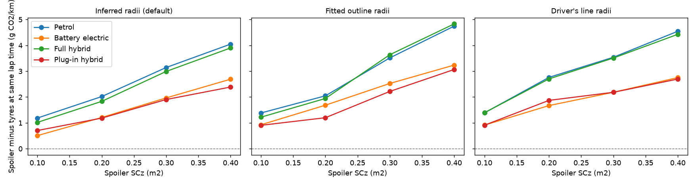

# Study C: cornering speed

**Status: DRAFT (third pass by Claude Opus 5.5, second pass by Gemini 4 Neon, first pass by Claude), for the owner to review.**
Every choice, comparison rule and description below is provisional for the owner to accept or
replace. Regenerate all saved CSVs and figures with `.venv/bin/python -m pwt.cornering`
(figures need `requirements-study-c.txt`).

## Choices (provisional, for the owner to review)

| Choice | Provisional value | Basis |
|---|---|---|
| Template corner speeds | Default: treated as set at μ₀ = 0.7 (inferred radii). Alternatives: radii fitted to the circuit outline (`--radius-method outline`), or the driver's line through them (`--radius-method line`). | On this coarse outline, the implied grip ranges from 0.34 to 0.70. No single grip value lies inside every corner's band (table below), so the spread is larger than the window and line choices account for. It is evidence for the owner to weigh in Task 2, not a finding. Inferred radii remain the default so the plan baseline reproduces exactly. |
| Reference grip μ₀ | 0.7 | Course sheet `11 Good trajectory speed.pdf` uses γ = 0.7 g. |
| Corner radii | Default inferred: R = v² / (μ₀ g) = 18.0 m to 112.4 m. Alternative outline: least-squares circle fitted within ±40 m of each apex = 20.3 m to 126.5 m. Driver's line: fitted radius plus 5.0 m = 25.3 m to 131.5 m. | Selectable in `pwt.cornering` via `radius_method="inferred"`, `"outline"` or `"line"`. |
| Half track width | 5.0 m (`TRACK_HALF_WIDTH_M`) | ASSUMPTION, unsourced and not measured corner by corner (see `docs/sources.md`). Used only by the driver's line. |
| Spoiler downforce | SCz = 0.1 to 0.4 m² | Provisional range bracketed by published road-car and track-day rear wings (see `docs/sources.md`). |
| Spoiler drag | Added SCx = SCz / 4 (lift-to-drag 4) | ASSUMPTION, unsourced for this vehicle body (see `docs/sources.md`). |
| Spoiler mass | 40 kg per m² of SCz (4 to 16 kg) | ASSUMPTION, linear scaling unsourced; 4 to 16 kg brackets a 6.8 kg carbon wing kit up to a larger aero assembly (see `docs/sources.md`). |
| Like-for-like rule | Matched on lap time (`match_by="lap_time"`) | Provisional choice for the owner. `MATCH_RULES` in `pwt/cornering.py` is structured so another rule (average corner-speed gain, or one reference corner) can be added. |
| Lap and vehicles | Generated by Petrol (`franco_sport_generated`, "storage losses" scenario), driven by Petrol, Battery electric, Full hybrid and Plug-in hybrid. Spoiler variants apply added drag and mass to both the lap-generating car and every car in `sweep`. | Repo convention and plan Task 7. |

## Corner radii and implied grip on the circuit outline

The outline in `data/track/spa-francorchamps.geojson` (`bacinger/f1-circuits`) is coarse:
152 unique vertices over 6978.4 m, with vertex spacing from 8.4 m to 377.0 m (median 21.3 m,
mean 45.9 m). It gives a single centreline with no track width or banking. Corners at 890 m,
1130 m and 5100 m have no anchor in `pwt/trackmap.py`, so their outline positions are
interpolated between their neighbours.

For each of the 12 set-speed corners, `pwt.cornering`:

1. resamples the outline every 5 m along a curve through its vertices (centripetal
   Catmull-Rom; straight lines between vertices would put every point on a chord and shrink
   the fitted radius);
2. maps the model distance onto the outline through `pwt.trackmap.ANCHORS`;
3. takes as apex the point within ±120 m that turns most within ±40 m;
4. fits one circle by least squares to the points within ±40 m of that apex.

The driver's line radius adds half a track width, 5.0 m, an ASSUMPTION. The band column gives
the implied grip across fits at half-windows of 25, 40 and 60 m and the driver's line. The
old method, the smallest 3-vertex circumradius within ±120 m, is kept as a comparison column;
taking a minimum keeps every kink in the outline.

Corner 5100 has its apex at the edge of the ±120 m search, so its radius is the least
reliable of the 12.

**La Source check.** No published radius was found (see `docs/sources.md`). The fitted
centreline radius is 20.3 m and the driver's line 25.3 m, against the plan's rough 35 m. Across
the 25 to 60 m windows the fit spans 16.3 m to 26.3 m. The old 3-vertex method gave 13.3 m.

On this coarse outline, the implied grip ranges from 0.34 to 0.70. No single grip value lies
inside every corner's band: Pouhon's is 0.33 to 0.34 and Bruxelles' is 0.63 to 0.70.

| Distance (m) | Landmark | Template speed (km/h) | Inferred R (m) | Fitted R (m) | Driver's line R (m) | Fitted R over 25 to 60 m windows (m) | Old 3-vertex R (m) | Implied μ, fitted | Implied μ band |
|---|---|---|---|---|---|---|---|---|---|
| 220 | La Source | 40.0 | 18.0 | 20.3 | 25.3 | 16.3 to 26.3 | 13.3 | 0.62 | 0.48 to 0.77 |
| 890 | - | 100.0 | 112.4 | 125.8 | 130.8 | 125.8 to 128.7 | 102.5 | 0.63 | 0.60 to 0.63 |
| 1130 | - | 100.0 | 112.4 | 126.5 | 131.5 | 103.6 to 163.6 | 92.3 | 0.62 | 0.48 to 0.76 |
| 2200 | Les Combes | 65.0 | 47.5 | 50.1 | 55.1 | 43.9 to 59.6 | 36.7 | 0.66 | 0.56 to 0.76 |
| 2470 | - | 65.0 | 47.5 | 60.3 | 65.3 | 56.1 to 69.8 | 45.4 | 0.55 | 0.48 to 0.59 |
| 2870 | Bruxelles | 65.0 | 47.5 | 47.7 | 52.7 | 47.7 to 49.2 | 38.3 | 0.70 | 0.63 to 0.70 |
| 3110 | - | 65.0 | 47.5 | 52.6 | 57.6 | 48.6 to 61.7 | 43.8 | 0.63 | 0.54 to 0.68 |
| 3600 | Pouhon | 65.0 | 47.5 | 96.8 | 101.8 | 96.8 to 99.9 | 80.4 | 0.34 | 0.33 to 0.34 |
| 4280 | Fagnes | 65.0 | 47.5 | 77.6 | 82.6 | 75.8 to 82.1 | 68.9 | 0.43 | 0.40 to 0.44 |
| 4740 | Stavelot | 65.0 | 47.5 | 51.4 | 56.4 | 51.4 to 55.8 | 42.6 | 0.65 | 0.59 to 0.65 |
| 5100 | - | 80.0 | 71.9 | 99.9 | 104.9 | 99.9 to 107.6 | 95.1 | 0.50 | 0.47 to 0.50 |
| 6540 | Bus Stop | 40.0 | 18.0 | 23.2 | 28.2 | 18.6 to 30.7 | 14.1 | 0.54 | 0.41 to 0.68 |

Full table, with apex positions and speeds at μ₀ = 0.7: `docs/study-c-corners.csv`.

## Results (Francorchamps sport, generated; "storage losses" scenario)

Baseline check passes: 235.1 s and 385.2 g CO2/km for Petrol across the 12 set-speed corners.
`short_steps` is 0 everywhere (every Petrol, Battery electric, Full hybrid and Plug-in hybrid
run in `study-c-results.csv`, `study-c-results-outline.csv`, `study-c-results-line.csv` and
`study-c-comparison.csv` is feasible).

### Default method: inferred radii (`docs/study-c-results.csv`)

| Case | Lap time (s) | Petrol (g CO2/km) | Battery electric (g CO2/km) | Full hybrid (g CO2/km) | Plug-in hybrid (g CO2/km) |
|---|---|---|---|---|---|
| Grip ×0.9 | 239.2 | 388.4 | 131.9 | 398.1 | 294.9 |
| Grip ×1.0 (baseline) | 235.1 | 385.2 | 132.2 | 395.2 | 293.0 |
| Grip ×1.1 | 231.3 | 381.7 | 132.1 | 391.6 | 290.6 |
| Grip ×1.2 | 227.9 | 378.2 | 132.4 | 388.3 | 288.1 |
| Grip ×1.3 | 224.7 | 375.2 | 132.7 | 385.6 | 286.0 |
| Spoiler SCz 0.1 m² | 235.4 | 386.5 | 132.6 | 396.3 | 293.8 |
| Spoiler SCz 0.2 m² | 235.8 | 387.5 | 133.3 | 397.2 | 294.3 |
| Spoiler SCz 0.3 m² | 236.2 | 388.9 | 134.0 | 398.5 | 295.2 |
| Spoiler SCz 0.4 m² | 236.5 | 390.2 | 134.7 | 399.8 | 295.9 |

- **Tyres:** each 0.1 step in grip factor saves 3.2 to 4.1 s and 2.7 to 3.6 g CO2/km (Petrol,
  Full hybrid), through less braking into corners and less rebuilding of speed out of them.
- **Spoiler:** under these assumptions, both lap time and EU CO2 worsen with SCz. Corner
  speeds are 40 to 100 km/h, so downforce adds little speed in corners while drag and mass
  penalise every straight.
- **Powertrains:** Battery electric (about 132 g CO2/km EU, 38.6 g CO2/km France at baseline)
  is nearly flat with tyre grip because regeneration recovers braking energy, but still rises
  with spoiler drag (+2.5 g CO2/km EU at SCz 0.4 m²). Full hybrid and Plug-in hybrid follow
  the Petrol direction. Powertrain rankings do not change.

### Alternative method: fitted outline radii (`docs/study-c-results-outline.csv`)

| Case | Lap time (s) | Petrol (g CO2/km) | Battery electric (g CO2/km) | Full hybrid (g CO2/km) | Plug-in hybrid (g CO2/km) |
|---|---|---|---|---|---|
| Grip ×0.9 | 230.4 | 378.7 | 131.9 | 388.7 | 287.9 |
| Grip ×1.0 (outline μ₀ = 0.7) | 226.1 | 374.4 | 131.9 | 384.7 | 284.8 |
| Grip ×1.3 | 215.1 | 362.9 | 132.3 | 373.8 | 276.2 |
| Spoiler SCz 0.2 m² | 226.7 | 377.2 | 133.6 | 387.4 | 286.7 |
| Spoiler SCz 0.4 m² | 227.3 | 380.4 | 135.1 | 390.7 | 288.8 |

### Alternative method: driver's line radii (`docs/study-c-results-line.csv`)

| Case | Lap time (s) | Petrol (g CO2/km) | Battery electric (g CO2/km) | Full hybrid (g CO2/km) | Plug-in hybrid (g CO2/km) |
|---|---|---|---|---|---|
| Grip ×0.9 | 227.2 | 375.5 | 132.2 | 385.9 | 285.8 |
| Grip ×1.0 (line μ₀ = 0.7) | 222.8 | 371.0 | 132.4 | 381.7 | 282.5 |
| Grip ×1.3 | 211.7 | 358.4 | 132.0 | 369.4 | 272.7 |
| Spoiler SCz 0.2 m² | 223.4 | 374.3 | 134.0 | 384.9 | 284.8 |
| Spoiler SCz 0.4 m² | 223.9 | 376.9 | 135.0 | 387.2 | 286.2 |

Every fitted radius is larger than its inferred radius, so at μ₀ = 0.7 every corner is faster
than its template speed. The Petrol lap takes 226.1 s on the fitted radii and 222.8 s on the
driver's line, against 235.1 s, with EU CO2 of 374.4 and 371.0 against 385.2 g CO2/km. On both,
Petrol lap time and EU CO2 fall with grip and rise with SCz, as on inferred radii.

## Like-for-like comparison: spoiler versus tyres (`docs/study-c-comparison.csv`)

**Provisional matching rule:** matched on lap time (`match_by="lap_time"`). For each spoiler
size, `pwt.cornering.spoiler_vs_tyres` finds the tyre grip factor whose sport lap matches the
spoiler lap time (within 0.01 s) and compares EU CO2 across all four powertrains.

Matched on lap time, a provisional rule. Matching on the average corner speed or on one
reference corner could change the result; the owner to choose.

Because the spoiler slows the lap under these assumptions, the matched tyre grip factor is
below 1.0 (0.991 down to 0.964 under inferred radii, 0.993 down to 0.970 under fitted outline
radii, and 0.993 down to 0.972 on the driver's line). At the same lap time, the spoiler still
produces higher EU CO2 than tyres for every powertrain because its added drag and mass act on
every straight.

### Inferred radii (default), matched on lap time

| Spoiler SCz (m²) | Lap time (s) | Matched grip factor | Petrol ΔCO2 (g CO2/km) | Battery electric ΔCO2 (g CO2/km) | Full hybrid ΔCO2 (g CO2/km) | Plug-in hybrid ΔCO2 (g CO2/km) |
|---|---|---|---|---|---|---|
| 0.1 | 235.4 | 0.991 | +1.2 | +0.5 | +1.0 | +0.7 |
| 0.2 | 235.8 | 0.982 | +2.0 | +1.2 | +1.8 | +1.2 |
| 0.3 | 236.2 | 0.973 | +3.1 | +2.0 | +3.0 | +1.9 |
| 0.4 | 236.5 | 0.964 | +4.0 | +2.7 | +3.9 | +2.4 |

### Outline radii, matched on lap time

| Spoiler SCz (m²) | Lap time (s) | Matched grip factor | Petrol ΔCO2 (g CO2/km) | Battery electric ΔCO2 (g CO2/km) | Full hybrid ΔCO2 (g CO2/km) | Plug-in hybrid ΔCO2 (g CO2/km) |
|---|---|---|---|---|---|---|
| 0.1 | 226.4 | 0.993 | +1.4 | +0.9 | +1.2 | +0.9 |
| 0.2 | 226.7 | 0.985 | +2.0 | +1.7 | +1.9 | +1.2 |
| 0.3 | 227.0 | 0.978 | +3.5 | +2.5 | +3.6 | +2.2 |
| 0.4 | 227.3 | 0.970 | +4.7 | +3.2 | +4.8 | +3.1 |

### Driver's line radii, matched on lap time

| Spoiler SCz (m²) | Lap time (s) | Matched grip factor | Petrol ΔCO2 (g CO2/km) | Battery electric ΔCO2 (g CO2/km) | Full hybrid ΔCO2 (g CO2/km) | Plug-in hybrid ΔCO2 (g CO2/km) |
|---|---|---|---|---|---|---|
| 0.1 | 223.1 | 0.993 | +1.4 | +0.9 | +1.4 | +0.9 |
| 0.2 | 223.4 | 0.987 | +2.8 | +1.7 | +2.7 | +1.9 |
| 0.3 | 223.7 | 0.979 | +3.5 | +2.2 | +3.5 | +2.2 |
| 0.4 | 223.9 | 0.972 | +4.5 | +2.8 | +4.4 | +2.7 |

Here ΔCO2 is spoiler EU CO2 minus lap-time-matched tyres EU CO2.

## Limits

- **Radii:** either inferred from the template speeds (assuming μ₀ = 0.7), or fitted to a
  coarse 152-vertex centreline outline with no banking. The driver's line adds an assumed
  5.0 m half track width to every corner alike.
- **One line:** the model has one line through each corner. The driver's-line option only
  widens each radius by a fixed amount; it does not model the line itself.
- **Fixed braking:** the sport lap brakes at a fixed 0.6 g; higher tyre grip could also allow
  harder braking, which is not modelled here.
- **Fixed speeds elsewhere:** only the 12 listed corners change speed; corners 16 and 17 stay
  straights.
- **Feasibility:** `short_steps` and `short_kw` are checked on every variant; no variant in
  these runs is infeasible (`short_steps` is 0 everywhere).
- **Spoiler assumptions:** while SCz = 0.1 to 0.4 m² is bracketed by published road-car and
  track-day wings, lift-to-drag 4 and linear 40 kg/m² mass scaling remain unsourced
  assumptions (see `docs/sources.md`). A much larger SCz, a higher L/D or a faster track would
  shift the spoiler trade-off.

## Not done (owner's)

- Confirm or replace every Task 2 choice (template speed meaning, μ₀, radius method and half
  track width, spoiler SCz / L/D / mass) and the provisional lap-time matching rule.
- Write the study's interpretation and conclusions.
- Task 8 slides.
